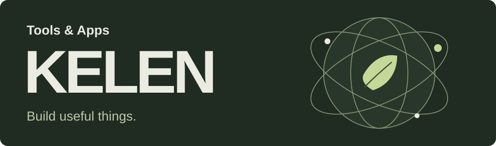

# 把重复工作，做成好用的工具

我是 Kelen，从 AI 内容创作和视频制作出发，做可复用的 Codex skills、macOS 小工具与网页交互实验。这里放能直接体验的演示、可下载的工具，以及对应的源码和使用说明。

**[体验 32 项网页交互 →](https://kelen1421.github.io/web-interaction-effects/)**　·　[下载 ai工作台](https://github.com/kelen1421/task-processing-progress-tool/releases/latest)　·　[浏览全部项目](https://github.com/kelen1421?tab=repositories)

## 工具与可复用项目

<table>
<tr>
<td width="50%" valign="top">
<h3>网页交互效果</h3>

把“像这样动起来”变成可操作的示例和可实施的需求。收录 32 项加载、滚动、悬停与弹簧拖拽演示，配套 Codex skill。

<strong><a href="https://kelen1421.github.io/web-interaction-effects/">在线体验</a></strong> · <a href="https://github.com/kelen1421/web-interaction-effects#安装与调用">安装 skill</a> · <a href="https://github.com/kelen1421/web-interaction-effects">源码</a>

HTML · JavaScript · Python · Codex skill

</td>
<td width="50%" valign="top">
<h3>ai工作台</h3>

macOS 置顶浮窗，查看 Codex 聊天任务的阶段与进度。支持任务固定、圆球模式和轻量内置对话，让任务状态留在手边。

<strong><a href="https://github.com/kelen1421/task-processing-progress-tool/releases/latest">下载 macOS 版</a></strong> · <a href="https://github.com/kelen1421/task-processing-progress-tool#怎么使用">使用说明</a> · <a href="https://github.com/kelen1421/task-processing-progress-tool">源码</a>

Swift · macOS · Codex

</td>
</tr>
</table>

## 交互与动效实验

| 项目 | 可以体验什么 | 入口 |
| --- | --- | --- |
| **动效档案** | 开场、Logo 与关键帧拆解；播放、暂停、变速和定位 | [在线演示](https://kelen1421.github.io/dongxiao/) · [源码与素材](https://github.com/kelen1421/dongxiao) |
| **弦外 · 一瞬** | 由滚轮推进、停滚定格的分层电影叙事原型；适合桌面横屏 | [在线体验](https://xianwai-scroll-story-kelen.kepaniizzard400.chatgpt.site/) · [源码](https://github.com/kelen1421/xianwai-scroll-story) |

## 使用与反馈

先体验演示或下载工具，再按各仓库 README 安装、运行。每个项目分别说明适用平台、已验证的行为与当前限制；遇到问题可在对应仓库的 Issues 提供复现步骤。

## 创作背景

我也做 AI 科技内容策划、科普视频编导和 IP 内容制作。工具来自这些实际工作中的重复步骤，网页实验则用来探索内容如何被看见和理解。

[简历与内容作品](https://kelen1421.github.io/kelen-/resume/)　·　[个人档案](https://kelen1421.github.io/kelen-/)　·　[《未解之问》栏目提案](https://kelen1421.github.io/proposal-library/)
