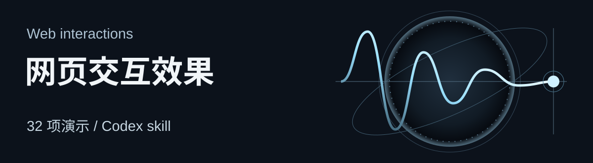
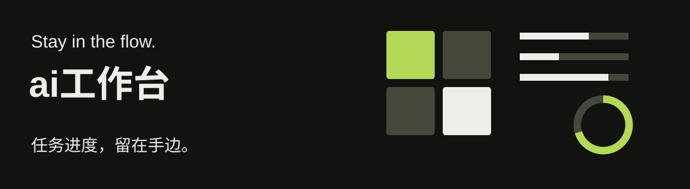

# 把想法，做成能用的工具。

从日常问题出发，制作可体验的交互、可复用的技能和随手可用的应用。

**[体验网页交互 ↗](https://web-interaction-effects-kelen.kepaniizzard400.chatgpt.site/)**　 ·　[下载 ai工作台 ↗](https://github.com/kelen1421/task-processing-progress-tool/releases/latest)

## 工具与技能

### 网页交互效果

把“像这样动起来”，转成准确术语、可操作示例和可实施的需求。调用时先展示完整效果目录与预览，再按目标解释、选型或实现。

**加载转场 · 滚动 · 悬停 · 弹簧与拖拽**，共 32 项教学演示。可以调整参数、复制需求描述，也可以下载后离线使用。

**[打开全部演示 ↗](https://web-interaction-effects-kelen.kepaniizzard400.chatgpt.site/)**　 ·　[安装 skill](https://github.com/kelen1421/web-interaction-effects#安装与调用)　 ·　[查看源码](https://github.com/kelen1421/web-interaction-effects)

HTML / JavaScript / Python / Codex skill

 

## 应用

### ai工作台

在其他应用工作时，也能看到 Codex 的任务进度。macOS 原生置顶浮窗，让任务阶段、完成提醒和最近对话留在手边。

**四宫格 · 条式列表 · 圆球模式**，支持固定任务与轻量内置对话。可选择适合当前工作的布局，再继续手上的事。

**[下载 macOS 版 ↗](https://github.com/kelen1421/task-processing-progress-tool/releases/latest)**　 ·　[安装与使用](https://github.com/kelen1421/task-processing-progress-tool#下载安装)　 ·　[查看源码](https://github.com/kelen1421/task-processing-progress-tool)

Swift / macOS 13+ / Apple 芯片与 Intel Mac

 

## 一起把工具做好

适用平台、安装方法和当前限制都写在项目说明中。遇到问题或有改进建议，欢迎附上复现步骤。

[反馈网页交互问题](https://github.com/kelen1421/web-interaction-effects/issues)　 ·　[反馈 ai工作台问题](https://github.com/kelen1421/task-processing-progress-tool/issues)
